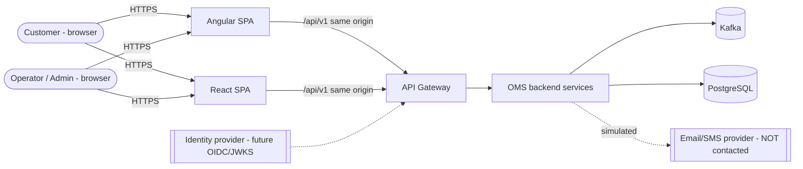
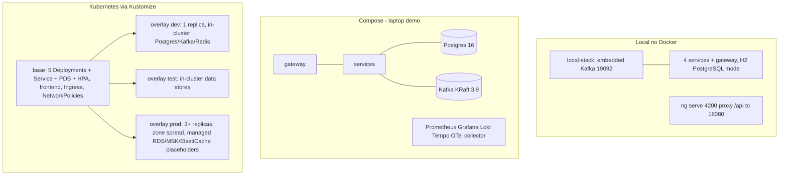

# High-Level Design (HLD) - Enterprise Order Management and Fulfillment Platform (OMS)

Status: living document. Normative source: `docs/architecture/00-shared-contract.md` (the "contract"). If this file and the contract disagree, the contract wins.
All data is synthetic. All modules described below exist on disk, are integration-tested and were exercised end to end on a local no-Docker stack (evidence: `docs/validation/validation-report.md`, `backend-test-summary.md`, `integration-defects.md`). Remaining gaps are listed in `docs/known-limitations.md`.

**Implemented modules (verified against the source tree):**
* `gateway/`: `TokenController` (`POST /api/v1/auth/token`, dev profile), `EdgeSecurityConfig`, `RoutesConfig` (static routes with circuit breaker and `/fallback/{service}`), `RateLimitWebFilter` with `InMemoryTokenBucketLimiter`, `RequestSizeLimitWebFilter`, `OpsHealthController` (`GET /api/v1/ops/health`), `ProblemErrorHandler`.
* `services/order-service`: `OrderController`, `CustomerController`, `AdminController` (`/api/v1/admin/...`), `OrderStateMachine`, `OrderSagaOrchestrator`, `OrderEventsListener`, `SagaRecoveryJob`, `ReconciliationService`, `IdempotencyKeyCleanupJob`, `RestInventoryClient`, order rate limiter (in-memory or Redis), migrations `V10`..`V12` and seed `V1000`.
* `services/inventory-service`: `InventoryEventsListener`, `ReservationService` with three strategies (`AtomicUpdateReservationStrategy`, `OptimisticVersionReservationStrategy`, `PessimisticLockReservationStrategy`), `ReservationLifecycleService`, `ReservationExpiryJob`, `ProductController`, `InventoryController`, `InternalController` (`POST /api/v1/internal/products/validate`), product cache (in-memory or Redis).
* `services/fulfillment-service`: `StartFulfillmentListener`, `FulfillmentService`, `FulfillmentProgressJob`, `FulfillmentStateMachine`, `FulfillmentController`.
* `services/notification-service`: `NotificationEventsListener`, `NotificationService`, `NotificationDeliveryJob`, `SimulatedSender`, `NotificationController`, migration `V10__notification_tables.sql`.
* `services/platform-common`: outbox, idempotent consumer, audit, security, errors, web filters, messaging and the retention purge (`RetentionPurgeJob`, see LLD section 3).
* Specs: `specs/openapi/` (5 files: gateway, order, inventory, fulfillment, notification) and `specs/events/` (envelope + 15 payload schemas). ADRs in `docs/adr/` (0001-0012).

## 1. Purpose and scope

OMS is a reference microservice platform: customers place orders through either of two feature-equivalent UIs (Angular 20, and React 19 with Redux Toolkit added later at the user's explicit request; ADR-0013); the platform validates the order, reserves inventory, confirms it, simulates fulfillment and notifies the customer. It exists to demonstrate and document, with working code where possible, patterns that matter in enterprise systems: transactional outbox, idempotent consumers, orchestrated saga with compensation, RFC 7807 errors, layered authorization, observability and Kubernetes delivery.

In scope: 4 business services, 1 edge gateway, 2 SPAs (Angular and React, same gateway contract), Kafka, PostgreSQL, optional Redis, observability stack, Compose and Kubernetes (Kustomize) delivery assets.
Out of scope: real payments, real email/SMS providers, real customer data, multi-region.

### Honest verification status (read this first)

| Area | State on the dev machine |
|---|---|
| `services/platform-common`, `platform-test-support`, `local-stack` | Implemented; unit and embedded-Kafka tests run (platform-common 66 unit tests at the last full reactor run). |
| order/inventory/fulfillment/notification services, `gateway/` | **Implemented and integration-tested.** Full reactor `mvn verify` (historic final run): 968 test cases (907 unit + 61 integration), 939 executed, 0 failed, 29 skipped (all Docker/PostgreSQL/benchmark). Two further tests (`RetentionPurgeJobTest`) were added afterwards. |
| Frontend `frontend/oms-ui` | Angular 20; 149 / 149 unit tests pass, `ng build` OK. Wired to the real gateway in live mode. |
| Frontend `frontend/oms-ui-react` (2026-10-19) | React 19 + Redux Toolkit/RTK Query + MUI; Vitest 207 / 207, coverage 96.3 % statements / 93.5 % branches, ESLint 0 errors, build OK, `npm audit` 0. Docker image, compose profile `react` and Kubernetes manifest never built or applied. |
| Playwright e2e `tests/e2e` | The same 18 specs, per UI (`E2E_UI=angular` or `react`): Angular 18 / 18 live and 18 / 18 mock; React 18 / 18 live and 18 / 18 mock (live: UI -> gateway -> real services, `E2E_BASE_URL`; mock: `tests/e2e/mock-backend/server.js`). |
| Live scripts | `scripts/smoke-test.mjs` 10 / 10; `scripts/live-flows.mjs` 54 / 54; `tests/e2e/oversell-live.mjs` (30 parallel orders, stock 3): 3 FULFILLED, 27 REJECTED; `tests/e2e/resilience-live.mjs` passed. |
| Docker-dependent tests (Testcontainers PostgreSQL) | **Skipped** (28 tests; Docker is not installed, `@Testcontainers(disabledWithoutDocker = true)`) plus 1 opt-in benchmark. No runtime evidence on real PostgreSQL; H2 in PostgreSQL mode ran the same Flyway SQL. |
| Compose, Kubernetes, Terraform, CI workflow | **Statically validated only** (kustomize build, kubeconform -strict, terraform validate, YAML parse; `scripts/validate-infra.sh` 47 PASS, 0 FAIL, 2 SKIP). Never applied to a cluster, never executed on a CI runner. |

## 2. System context (C4 level 1)



Actors: CUSTOMER (own orders only), OPERATOR (read all, adjust stock, retry), ADMIN (everything), SERVICE (machine identity for `/api/v1/internal/**`). In the demo the gateway itself mints dev JWTs (profile `dev` only); production is expected to use an external OIDC provider.

## 3. Containers (C4 level 2)

```
                         +------------------+
 Browser ---HTTPS--->    | nginx + Angular  |  frontend/oms-ui (port 8080 in container, 4200 dev)
   (or the React UI:     | (or nginx+React) |  frontend/oms-ui-react (8080 in container, 4201 dev)
    never both at once   +--------+---------+
    behind the Ingress)
                                  | /api  (same origin, no CORS needed)
                         +--------v---------+  JWT validation, CORS, rate limit (Redis or in-memory),
                         |   api-gateway    |  X-Correlation-Id, route table           :18080
                         +--+----+----+---+-+
              +-------------+    |    |   +---------------+
     +--------v-------+  +-------v----+--+  +-------------v---+  +-------------------+
     | order-service  |  | inventory-svc |  | fulfillment-svc |  | notification-svc  |
     | :18081         |  | :18082        |  | :18083          |  | :18084            |
     | order_db       |  | inventory_db  |  | fulfillment_db  |  | notification_db   |
     +---+----+---+---+  +---+-----------+  +--------+--------+  +---------+---------+
         |    |   |          ^   ^                   ^                     ^
         |    |   +--REST----+   |  (order -> inventory /internal/products/validate, SERVICE JWT)
         |    |                  |
         v    v                  v
     +---------------------------------------------------------------------+
     |  Kafka (KRaft): oms.order.events.v1  oms.inventory.commands.v1       |
     |  oms.inventory.events.v1  oms.fulfillment.commands.v1                |
     |  oms.fulfillment.events.v1  + <topic>.DLT          local :19092      |
     +---------------------------------------------------------------------+
     Redis (optional): rate-limit buckets, product read cache; off locally (oms.redis.enabled=false)
```

| Container | Tech | Port | Owns | Status |
|---|---|---|---|---|
| frontend (Angular) | Angular 20, Material, nginx image | 4200 / 8080 | UI only; runtime `config.json` | exists: `frontend/oms-ui` |
| frontend (React) | React 19, Redux Toolkit/RTK Query, React Router, MUI, nginx image | 4201 / 8080 | UI only; runtime `config.json`; no server data in slices | exists: `frontend/oms-ui-react` (image and K8s manifest never built or applied) |
| api-gateway | Spring Cloud Gateway (reactive) | 18080 | routes, edge JWT check, rate limit | implemented: `gateway/` |
| order-service | Spring Boot 3.5.16, Java 17 | 18081 | customers, orders, order_items, order_status_history, saga_instances, saga_step_log, idempotency_keys | implemented: `services/order-service` (API, saga, listeners, recovery, reconciliation) |
| inventory-service | same | 18082 | products, stock, reservations, stock_movements | implemented: `services/inventory-service` (API, listeners, strategies, expiry job) |
| fulfillment-service | same | 18083 | fulfillments, fulfillment_events | implemented: `services/fulfillment-service` |
| notification-service | same | 18084 | notifications, notification_attempts, order_contacts | implemented: `services/notification-service` |
| platform-common | shared library (auto-configuration) | n/a | outbox, processed_events, audit, security, errors, web filters, messaging | exists: `services/platform-common` |
| platform-test-support | test library | n/a | `AbstractKafkaIT`, `AbstractPostgresIT`, `JwtTestTokens`, `Awaits`, `JsonAssertions` | exists |
| local-stack | executable embedded Kafka | 19092 | dev/test broker (`LocalStackApplication`, `TopicCatalog`) | exists: `services/local-stack` |

Each service has its own database (`order_db`, `inventory_db`, `fulfillment_db`, `notification_db`; separate in-memory H2 locally). No cross-service DB access. Every service also carries the three platform-common tables (`outbox_events`, `processed_events`, `audit_events`).

## 4. Data and control flow

### 4.1 Happy path (create order to FULFILLED)

```mermaid
sequenceDiagram
  autonumber
  participant UI as Angular UI
  participant GW as api-gateway
  participant OS as order-service
  participant INV as inventory-service
  participant FUL as fulfillment-service
  participant NOT as notification-service
  UI->>GW: POST /api/v1/orders (Idempotency-Key, Bearer JWT)
  GW->>OS: forward + X-Correlation-Id
  OS->>OS: tx: insert order CREATED + idempotency row + outbox OrderCreated + audit
  OS-->>UI: 202 Accepted (status CREATED)
  OS->>INV: POST /internal/products/validate (SERVICE JWT, CB + retry)
  OS->>OS: CREATED -> VALIDATED, outbox ReserveInventory
  OS-)INV: oms.inventory.commands.v1 ReserveInventory
  INV->>INV: tx: conditional UPDATE stock + reservation + outbox InventoryReserved
  INV-)OS: oms.inventory.events.v1 InventoryReserved
  OS->>OS: INVENTORY_RESERVED -> CONFIRMED, outbox OrderConfirmed + StartFulfillment
  OS-)FUL: oms.fulfillment.commands.v1 StartFulfillment
  FUL-)OS: oms.fulfillment.events.v1 FulfillmentCompleted
  FUL-)INV: same event: commit stock (on_hand -= q; reserved -= q)
  OS->>OS: CONFIRMED -> FULFILLED, outbox OrderFulfilled
  OS-)NOT: oms.order.events.v1 -> simulated notification
```

The client polls `GET /api/v1/orders/{id}` (UI polling with backoff; config keys `pollIntervalMs`, `pollMaxIntervalMs`). There is no WebSocket/SSE in v1.

### 4.2 Failure and compensation paths

* Insufficient stock: `InventoryReservationFailed` -> VALIDATED -> REJECTED (reason shown in UI).
* Fulfillment failure (`FAILTOWN` shipping city or random rate): `FulfillmentFailed` -> CONFIRMED -> COMPENSATION_PENDING, command `ReleaseInventory` -> `InventoryReleased` -> FAILED.
* Cancel after reservation: INVENTORY_RESERVED/CONFIRMED -> COMPENSATION_PENDING -> CANCELLED.
* Stuck step: `SagaRecoveryJob` (every `oms.saga.recovery-interval-ms`, default 10 s) re-sends the idempotent command after `oms.saga.stuck-after-seconds`; after `oms.saga.max-attempts` the order is FAILED or flagged for manual/reconciliation.
* Consumer poison message: 4 attempts with backoff (500 ms x2 to 5 s) then `<topic>.DLT`; malformed/deserialization errors skip retries (verified by `ConsumerKafkaTest`).

Explicitly not distributed ACID: state is eventually consistent, compensations are semantic.

### 4.3 Delivery semantics (stated precisely)

* Producer side: transactional outbox (`OutboxService.append` requires an active transaction; a rolled-back transaction leaves no row - verified by `OutboxRelayKafkaTest.appendRequiresAnActiveTransaction` and `rolledBackTransactionLeavesNoOutboxRow`). `OutboxRelay` publishes with acks=all, idempotence on, marks `published_at`. Result: **at-least-once**.
* Consumer side: `IdempotentEventProcessor.processOnce(consumer, envelope, effect)` inserts `(consumer, event_id)` into `processed_events` in the same transaction as the effect. Result: **effectively-once business effect**, not exactly-once delivery.
* Ordering: key = `orderId`, so ordering holds per order within a partition only.

## 5. Deployment view



Files on disk: `infrastructure/compose/docker-compose.yml` and `docker-compose.observability.yml`; `infrastructure/kubernetes/{base,overlays/dev|test|prod,dev-dependencies,monitoring,keda,examples}`; `infrastructure/docker/*.Dockerfile`; `infrastructure/cloud/aws/terraform/*.tf` (EKS, network, ECR, secrets); `.github/workflows/ci.yml`; `infrastructure/ci/Jenkinsfile`; `observability/{prometheus,grafana,loki,otel,tempo}`. See `deployment-and-rollback.md` for procedure.

Key runtime properties of the base manifests (verified by reading `infrastructure/kubernetes/base/order-service.yaml`): RollingUpdate `maxSurge: 1, maxUnavailable: 0`; startup, readiness and liveness probes on `/actuator/health/{liveness,readiness}`; `preStop: sleep 10`, `terminationGracePeriodSeconds: 45`; non-root user 10001, read-only root filesystem, all capabilities dropped; HPA 2-6 on CPU 70 percent; PDB `minAvailable: 1` (prod overlay raises to 2 for order, inventory, gateway).

## 6. Non-functional requirements

Targets are design goals. The Evidence column states what was actually run.

| ID | Quality | Requirement | Mechanism | Evidence |
|---|---|---|---|---|
| NFR-01 | Availability | No order lost when a pod is killed mid-flight | outbox + idempotent consumers + graceful shutdown | outbox/consumer tests verified (embedded Kafka); pod-kill not tested |
| NFR-02 | Latency | `POST /orders` p95 < 300 ms (accepts, does not wait for saga) | 202 + async saga | k6 scripts exist (`performance/order-flow.js`, `performance/oversell.js`); `node --check` only (no k6 binary), no latency numbers exist |
| NFR-03 | Throughput | 100 orders/s sustained at 3 partitions | partitions=3, KEDA cap 3 | not measured |
| NFR-04 | Consistency | Stock never oversold | atomic conditional UPDATE `on_hand - reserved >= :q` | verified live: 30 parallel orders for stock 3 gave 3 FULFILLED / 27 REJECTED, never above 3 committed; PostgreSQL concurrency ITs skipped (no Docker) |
| NFR-05 | Idempotency | Same `Idempotency-Key` + body replays original response | `IdempotencyKeys.fingerprint` + `idempotency_keys` table | helper verified (`PageRequestFactoryTest.idempotencyKeyValidation`); `POST /api/v1/orders` implemented in `OrderController`, replay exercised by `live-flows.mjs` (54/54) |
| NFR-06 | Security | Backend-authoritative authz, fail-fast secrets | method security, `CurrentUser`, `JwtSecret` | verified in `SecurityApiTest`, `JwtSecretTest` |
| NFR-07 | Observability | Correlation id on every log line, request and Kafka header | `CorrelationIdFilter`, MDC, Kafka headers | filter verified (`WebFiltersTest`); Kafka propagation verified in `ConsumerKafkaTest` (MDC) |
| NFR-08 | Recoverability | Stuck sagas self-heal | `SagaRecoveryJob`, `ReconciliationService` (also `POST /api/v1/admin/reconciliation/run`) | implemented; `resilience-live.mjs` passed (order parked while fulfillment down, completes after restart, exactly one fulfillment row) |
| NFR-09 | Portability | Same Flyway SQL on H2 (PostgreSQL mode) and PostgreSQL 16 | portable SQL, no pg-only types | H2 path exercised; PG path **skipped** without Docker |
| NFR-10 | Scalability | Horizontal scale of stateless pods | HPA, consumer groups | manifests validated statically only |
| NFR-11 | Maintainability | Additive-only API v1; tolerant reader events | `docs/architecture/api-versioning.md`, `EventEnvelope` | `EventEnvelopeTest` |
| NFR-12 | Payload limits | JSON body <= 64 KB | `RequestSizeLimitFilter` | verified (`WebFiltersTest`: 413 problem+json, chunked body counted) |
| NFR-13 | Resilience to dependency outage | Kafka down does not fail the request path; outbox retries in order | `OutboxRelay` | verified (`OutboxRelayResilienceTest`) |

## 7. Cross-cutting design decisions

| Concern | Decision | Where |
|---|---|---|
| Errors | RFC 7807 `application/problem+json` with `code`, `correlationId`, `errors[]` | `ProblemFactory`, `ProblemWriter`, `GlobalExceptionHandler`, `ProblemSecurityHandlers` |
| AuthN | JWT HS256 in demo, OIDC/JWKS switch by property; `OMS_JWT_SECRET` has no default | `JwtSecurityAutoConfiguration`, `JwtSecret` |
| AuthZ | Roles in JWT, method security plus resource-level `CurrentUser.canAccessCustomer`; cross-customer reads return 404 | `CurrentUser`, `Roles` |
| Retention | `RetentionPurgeJob` purges `processed_events` (14 d default) and `audit_events` (365 d default) via `oms.retention.*`; published outbox rows via `oms.outbox.*` | `RetentionPurgeJob`, `RetentionProperties`, `OmsRetentionAutoConfiguration` |
| Config | Defaults supplied via `META-INF/oms-defaults.properties` and `OmsDefaultsEnvironmentPostProcessor` | platform-common |
| Paging | 0-based, size 1..100, whitelisted sort, never clamped silently | `PageRequestFactory`, `PageResponse` |
| Ops endpoints | `/api/v1/ops/messaging`, `/api/v1/ops/audit` auto-registered | `OpsMessagingController`, `OpsAuditController` |
| Logging | JSON logs profile; masking helpers | `logback-spring.xml`, `LogMasking` |
| Metrics | Micrometer names in contract section 7 | `Metrics`, `MessagingMetrics` |

Architecture Decision Records live in `docs/adr/` (0001-0013: microservices vs modular monolith, Kafka event design, saga orchestration vs choreography, database per service, idempotency, concurrency control, API versioning, CI/CD, transactional outbox, JWT/OIDC, observability, Angular state, dual Angular and React front ends). Related architecture notes: `docs/architecture/{saga-and-consistency,delivery-semantics,event-schema-evolution,api-versioning,angular-architecture,react-architecture}.md`.

### 7.1 Front-end view: two UIs, one contract

Both UIs are thin clients of the same `/api/v1` gateway contract; nothing in the backend knows which one calls. The React UI splits state into **server state** (RTK Query cache keyed by endpoint and arguments, tag invalidation after writes, polling for order detail) and **client state** (slices `auth`, `cart`, `ui`); screen-local state (filters, form values) stays in components. One `omsBaseQuery` plays the role of the Angular interceptor chain (correlation id, bearer token, GET-only retry, problem+json normalization, 401 logout, 429 toast). The Angular UI keeps signal stores and RxJS pipelines (ADR-0012). Parity is enforced by the same 18 Playwright specs run per UI (`E2E_UI`), not by shared code; the type definitions are a verbatim copy in each app (drift risk, see `docs/known-limitations.md`). Component and state layout of the React app: `docs/architecture/react-architecture.md` and `docs/diagrams/react-architecture.mmd`.

## 8. Constraints, assumptions, risks

* Java 17, Spring Boot 3.5.16, Maven reactor `services/pom.xml` (service modules are profile-activated when their `pom.xml` exists).
* Redis is optional; every use degrades to in-memory.
* Gateway static route URIs are read from `oms.gateway.routes.*.uri` (`RoutesConfig`, `GatewayProperties`); keep `infrastructure/README.md` consistent with those names.
* See `risk-register.md` for the full list.

## 9. Known limitations

See `docs/known-limitations.md` (not executed: Docker, Kubernetes, Terraform, k6, PostgreSQL runtime; design limits such as unclaimed scheduled jobs across replicas, no DLT replay tool, OIDC mode untested). Defects found and fixed during live integration: `docs/validation/integration-defects.md`.
