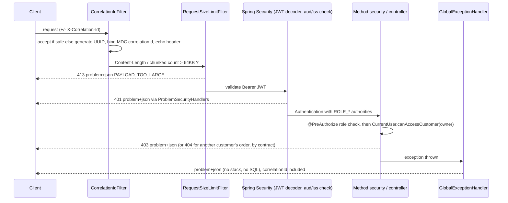
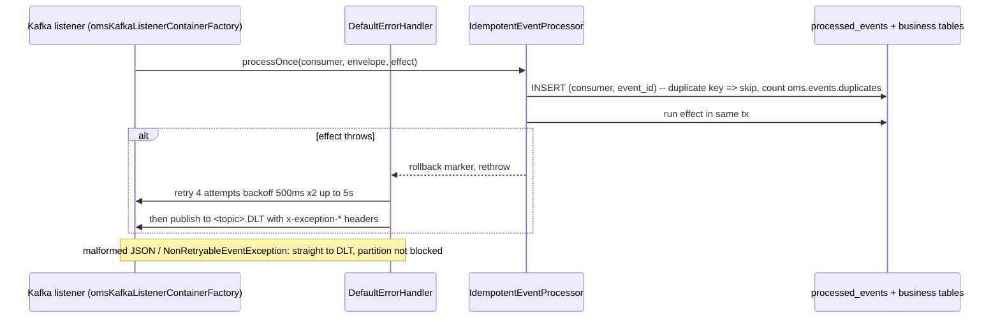

# Low-Level Design (LLD) - OMS

Companion to `HLD.md`. Normative source: `docs/architecture/00-shared-contract.md`. All modules are implemented; class names below were checked against the source tree under `services/*/src/main/java` and `gateway/src/main/java`. Evidence of behaviour is in `docs/validation/` and remaining gaps in `docs/known-limitations.md`.

## 1. Module and package map (verified)

Java package root `com.enterprise.oms.<module>`; platform-common is `com.enterprise.oms.common`.

| Package | Key classes (verified) | Responsibility |
|---|---|---|
| `autoconfigure` | `OmsCoreAutoConfiguration`, `OmsPersistenceAutoConfiguration`, `OmsKafkaAutoConfiguration`, `OmsMessagingAutoConfiguration`, `OmsOutboxAutoConfiguration`, `OmsAuditAutoConfiguration`, `OmsWebAutoConfiguration`, `JwtSecurityAutoConfiguration`, `OmsDefaultsEnvironmentPostProcessor`, `OmsKafkaProperties` | Wires everything when the jar is on the classpath; supplies default properties (`META-INF/oms-defaults.properties`). |
| `security` | `JwtSecret`, `JwtTokenFactory`, `ServiceTokenProvider`, `CurrentUser`, `Roles`, `OmsSecurityProperties`, `OmsAuthorizeRequestsCustomizer`, `ProblemSecurityHandlers` | HS256 secret handling (fail-fast, min 32 bytes), token minting for dev and service calls, caller identity, 401/403 as problem+json. |
| `error` | `ErrorCode`, `OmsException` and subclasses (`NotFoundException`, `ConflictException`, `ForbiddenException`, `InvalidStateTransitionException`, `InsufficientStockException`, `IdempotencyKeyRequiredException`, `IdempotencyKeyReusedException`, `RequestValidationException`, `RateLimitedException`, `PayloadTooLargeException`, `UpstreamUnavailableException`), `FieldError`, `ProblemFactory`, `ProblemWriter`, `GlobalExceptionHandler` | Single error contract. |
| `web` | `CorrelationIds`, `CorrelationIdFilter`, `RequestSizeLimitFilter`, `WebProperties`, `PageRequestFactory`, `PageResponse`, `IdempotencyKeys` | Cross-cutting HTTP concerns. |
| `events` | `EventEnvelope<T>`, `EventPayloads`, `EventTypes`, `Topics`, `EventJson`, `MalformedEventException` | Event contract (envelope + payload records + topic names). |
| `outbox` | `OutboxEvent`, `OutboxEventRepository`, `OutboxService`, `OutboxRelay`, `OutboxProperties` | Transactional outbox and relay. |
| `idempotency` | `ProcessedEvent`, `ProcessedEventRepository`, `IdempotentEventProcessor` | Consumer-side de-duplication. |
| `retention` | `RetentionPurgeJob`, `RetentionProperties` (wired by `autoconfigure.OmsRetentionAutoConfiguration`) | Scheduled purge of `processed_events` and `audit_events` (`oms.retention.*`). |
| `messaging` | `EventRouter`, `EventRouterFactory`, `MessagingMetrics`, `MessagingProperties`, `MessagingStatus`, `MessagingStatusService`, `OpsMessagingController`, `NonRetryableEventException` | Consumer plumbing, DLT routing support, `/api/v1/ops/messaging`. |
| `audit` | `AuditEvent`, `AuditEventRepository`, `AuditEventView`, `AuditService`, `OpsAuditController` | Append-only audit and `/api/v1/ops/audit`. |
| `http` | `OmsRestClientFactory`, `HttpClientProperties` | Outbound REST with contract timeouts (connect 2 s / read 3 s). |
| `observability` | `LogMasking`, `Metrics` | PII/secret masking, metric names. |

Other modules (verified): `services/platform-test-support` (`AbstractKafkaIT`, `AbstractPostgresIT`, `JwtTestTokens`, `Awaits`, `JsonAssertions`), `services/local-stack` (`LocalStackApplication`, `TopicCatalog`).

Service packages (all on disk):
* `com.enterprise.oms.order`: `api` (`OrderController`, `CustomerController`, `AdminController`, `dto`, `OpenApiConfig`), `config`, `domain` (`OrderStateMachine`, `OrderStatus`, `OrderTrigger`, `SagaState`, `SagaStep`, `StepStatus`), `entity`, `ratelimit`, `repository`, `saga` (`OrderSagaOrchestrator`, `OrderEventsListener`, `SagaRecoveryJob`, `ReconciliationService`, `SagaTrigger`, `SagaMessaging`, `InventoryClient`/`RestInventoryClient`, `IdempotencyKeyCleanupJob`), `service` (`OrderCommandService`, `OrderQueryService`, `OrderTransitions`, `CustomerService`, `RetryingTransactions`).
* `com.enterprise.oms.inventory`: `cache`, `config`, `domain`, `messaging` (`InventoryEventsListener`), `metrics`, `repo`, `reservation` (strategies), `service` (`ReservationService`, `ReservationLifecycleService`, `ReservationExpiryJob`, `StockService`, `ProductService`, `ValidationService`), `web` (`ProductController`, `InventoryController`, `InternalController`).
* `com.enterprise.oms.fulfillment`: `api` (`FulfillmentController`), `config`, `domain` (`FulfillmentStateMachine`), `messaging` (`StartFulfillmentListener`), `service` (`FulfillmentService`, `FulfillmentProgressJob`, `FulfillmentRecovery`, `FailureSimulator`, `TrackingNumbers`).
* `com.enterprise.oms.notification`: `api` (`NotificationController`), `config`, `domain`, `messaging` (`NotificationEventsListener`), `sender` (`NotificationSender`, `SimulatedSender`), `service` (`NotificationService`, `NotificationDeliveryJob`, `BackoffPolicy`).
* `com.enterprise.oms.gateway`: `auth` (`TokenController`, `DemoCredentials`, `LoginThrottle`), `config` (`GatewayProperties`, `RoutesConfig`), `filter` (`EdgeFilters`, `RequestSizeLimitWebFilter`), `ops` (`OpsHealthController`), `problem` (`ProblemErrorHandler`, `FallbackController`, `Problems`), `ratelimit` (`RateLimitWebFilter`, `InMemoryTokenBucketLimiter`, `EdgeRateLimiter`), `security` (`EdgeSecurityConfig`).

## 2. Key class contracts (verified signatures)

| Class | Signature of interest | Notes |
|---|---|---|
| `CurrentUser` (record: `id`, `roles`, `customerId`) | `static find()`, `static require()`, `from(Authentication)`, `hasRole`, `isStaff()`, `canAccessCustomer(UUID owner)` | `canAccessCustomer` = staff OR (customer AND claim matches). Malformed `customerId` claim is treated as absent. |
| `Roles` | constants `CUSTOMER, OPERATOR, ADMIN, SERVICE`, `ALL` | Unknown roles in a token are ignored (`SecurityApiTest.unknownRolesAreIgnored`). |
| `JwtSecret` | `resolve(props, env)`, `of`, `random()`, `bytes()`, `ephemeral()`; `toString()` does not print the value | Fail-fast absent or < 32 bytes unless `allow-ephemeral-secret=true`. |
| `IdempotencyKeys` | `HEADER`, `require(String)`, `fingerprint(String body)` | Pattern `[A-Za-z0-9_-]{8,64}`; fingerprint is SHA-256 hex. |
| `PageRequestFactory` | `create(page, size, sorts, sortable, defaultSort)` | 400 `VALIDATION_FAILED` for out-of-range or non-whitelisted sort. |
| `ProblemWriter` | `write(request, response, ErrorCode, detail)` | Used by filters/security handlers where `@ControllerAdvice` does not apply. |
| `LogMasking` | `maskEmail`, `maskToken`, `sanitize`, `stripNewlines` | Contract: never log tokens, passwords, full emails. |
| `OutboxService` | `append(envelope)`, `append(topic, key, envelope[, headers])`, `pendingCount()` | Must run inside a transaction (verified by test). |
| `OutboxRelay` | scheduled publisher; fields from `OutboxProperties` | Keeps rows pending when the broker is unreachable (`OutboxRelayResilienceTest`). |
| `IdempotentEventProcessor` | `boolean processOnce(consumer, [topic,] envelope, Runnable effect)` | Returns false for duplicate; rolls back marker if effect throws. |
| `AuditService` | `record(entityType, entityId, action, detail)`, `record(actor, ...)`, `search(entityType, entityId, Pageable)` | Actor defaults from security context, else `system`. |

## 3. Shared tables (verified from `db/common/V1__outbox_processed_audit.sql`)

Portable SQL for PostgreSQL 16 and H2 (MODE=PostgreSQL). Version range V1..V8 is reserved for platform-common; service migrations start at V10; seeds at V1000+.

### outbox_events
| Column | Type | Constraint |
|---|---|---|
| id | UUID | PK |
| aggregate_type | VARCHAR(64) | NOT NULL |
| aggregate_id | VARCHAR(64) | NOT NULL |
| event_type | VARCHAR(100) | NOT NULL |
| topic | VARCHAR(200) | NOT NULL |
| event_key | VARCHAR(200) | nullable (Kafka key = orderId) |
| payload | VARCHAR(20000) | NOT NULL (JSON envelope) |
| headers | VARCHAR(4000) | nullable |
| created_at | TIMESTAMP WITH TIME ZONE | NOT NULL |
| published_at | TIMESTAMP WITH TIME ZONE | NULL until relayed |
| attempts | INTEGER | NOT NULL DEFAULT 0 |
| last_error | VARCHAR(1000) | nullable |

Indexes: `ix_outbox_pending (published_at, created_at)`, `ix_outbox_aggregate (aggregate_type, aggregate_id)`.
Design note: payload is capped at 20000 characters; an event larger than that fails the insert (a design limit). A cleanup job exists: `OutboxEventRepository.deletePublishedBefore` driven by `OutboxProperties` (`retention` default 1 hour, `cleanupEnabled` true, `cleanupIntervalMs` 60000); unpublished rows are never deleted. Retention for `processed_events` and `audit_events` is handled by `RetentionPurgeJob` (see below).

### processed_events
| Column | Type | Constraint |
|---|---|---|
| consumer | VARCHAR(100) | PK part 1 |
| event_id | UUID | PK part 2 (`pk_processed_events`) |
| event_type | VARCHAR(100) | nullable |
| topic | VARCHAR(200) | nullable |
| processed_at | TIMESTAMP WITH TIME ZONE | NOT NULL |

The primary key is the de-duplication mechanism. `RetentionPurgeJob` deletes rows with `processed_at` older than `oms.retention.processed-events-retention` (default 14 days, via `ProcessedEventRepository.deleteProcessedBefore`). The window must exceed the longest possible broker redelivery or DLT replay period: deleting a marker earlier re-opens that event to double processing.

### audit_events
| Column | Type | Constraint |
|---|---|---|
| id | UUID | PK |
| occurred_at | TIMESTAMP WITH TIME ZONE | NOT NULL |
| actor | VARCHAR(200) | NOT NULL |
| entity_type | VARCHAR(100) | NOT NULL |
| entity_id | VARCHAR(100) | NOT NULL |
| action | VARCHAR(100) | NOT NULL |
| detail | VARCHAR(8000) | nullable |
| correlation_id | VARCHAR(64) | nullable |

Indexes: `ix_audit_entity (entity_type, entity_id, occurred_at)`, `ix_audit_time (occurred_at)`. Append-only by convention only: no DB-level immutability (no trigger, no revoked UPDATE/DELETE). `RetentionPurgeJob` deletes rows with `occurred_at` older than `oms.retention.audit-events-retention` (default 365 days, via `AuditEventRepository.deleteOccurredBefore`), so strictly the application role needs DELETE on this table unless the purge runs under a separate role. Production recommendation: otherwise restrict the application role to INSERT/SELECT.

### Retention purge (`RetentionPurgeJob`)

`com.enterprise.oms.common.retention.RetentionPurgeJob`, wired by `OmsRetentionAutoConfiguration` (registered in `META-INF/spring/*.imports`) with `RetentionProperties` (`oms.retention.*`):

| Property | Default | Meaning |
|---|---|---|
| `oms.retention.enabled` | `true` | Master switch (`purge()` returns immediately when false). |
| `oms.retention.interval-ms` | `3600000` | Fixed delay and initial delay of the scheduled `purge()`. |
| `oms.retention.processed-events-retention` | 14 days | Age limit for `processed_events`. |
| `oms.retention.audit-events-retention` | 365 days | Age limit for `audit_events`. |

Each table is purged in its own transaction (`TransactionTemplate`); a failure is logged as a warning and retried on the next run, and never propagates out of the scheduled method. Safe on several replicas at once (idempotent delete by timestamp). Covered by `RetentionPurgeJobTest` (2 tests: purges only rows older than retention; disabled job deletes nothing), H2 only.

## 4. Service tables (contract sections 3, 6, 7, 8)

Migration status (all migrations exist on disk under `src/main/resources/db/migration`): order-service `V10__customers_orders.sql` (customers, orders, order_items with `uq_order_items_product (order_id, product_id)`, order_status_history), `V11__saga_idempotency.sql` (saga_instances with `uq_saga_order`, saga_step_log, idempotency_keys with `uq_idempotency_scope_key (scope, idem_key)`, columns `request_hash`, `order_id`, `response_status`, `response_body`), `V12__indexes.sql`; inventory-service `V10__inventory_schema.sql` (products with `ck_products_price`, stock with `ck_stock_non_negative` and `ck_stock_reserved_le_on_hand`, inventory_reservations with `ck_reservations_status`, inventory_reservation_items with `ck_resitems_qty`, stock_movements); fulfillment-service `V10__fulfillment_tables.sql` (fulfillments, fulfillment_events); notification-service `V10__notification_tables.sql` (order_contacts, notifications with `uq_notifications_event_template (source_event_id, template)`, notification_attempts). Seeds live under `db/seed` (`V1000__seed_customers.sql`, `V1000__seed_products.sql`). The table below keeps the contract's minimum column lists; the migration files are the authoritative DDL (the idempotency table, for example, is scoped by `(scope, idem_key)`, and inventory carries the CHECK constraints against overselling).

| Service | Table | Key columns and constraints implied by the contract |
|---|---|---|
| order | customers | id UUID PK, name, email, tier, created_at |
| order | orders | id UUID PK, customer_id FK, status, status_reason, total_amount NUMERIC(19,2), currency, shipping_* , correlation_id, created_at, updated_at, `version` (optimistic lock) |
| order | order_items | order_id FK, product_id, sku, name, quantity (1..1000), unit_price, line_total |
| order | order_status_history | order_id, from_status, to_status, reason, actor, occurred_at |
| order | saga_instances | order_id UNIQUE, state, current_step, attempts, last_error, reason, version, timestamps |
| order | saga_step_log | saga_id, step, status, attempt, detail, at |
| order | idempotency_keys | key, owner (caller id), request_fingerprint (SHA-256), response snapshot, order_id, created_at; unique on (owner, key) implemented as `uq_idempotency_scope_key (scope, idem_key)` |
| inventory | products | id UUID PK, sku UNIQUE, name, description, category, price, currency, active, version |
| inventory | stock | product_id PK/FK, on_hand, reserved, version; CHECK on_hand >= 0, reserved >= 0, reserved <= on_hand (implemented) |
| inventory | inventory_reservations (+ items) | id, order_id UNIQUE (duplicate ReserveInventory is a no-op), status RESERVED/COMMITTED/RELEASED/EXPIRED/FAILED, expires_at, release_reason |
| inventory | stock_movements | product_id, delta, reason, actor, correlation_id, at |
| fulfillment | fulfillments | id, order_id UNIQUE, status, tracking_number, attempts, failure_reason |
| fulfillment | fulfillment_events | fulfillment_id, status, at |
| notification | notifications | id, customer_id, order_id, channel, template, subject, status, attempts, last_error, correlation_id, source_event_id; UNIQUE (source_event_id, template) |
| notification | notification_attempts | notification_id, attempt, outcome, at |
| notification | order_contacts | per-order contact data used to address simulated notifications (`OrderContact`) |

Every service additionally owns the three shared tables. Seed data (synthetic UUIDs `c0000000-...-0001..0003`, products `SKU-1001..SKU-1020`) arrives as `V1000__seed_*` only under the `dev` profile.

## 5. Order state machine (`OrderStateMachine`)

Verified on disk: `services/order-service/src/main/java/com/enterprise/oms/order/domain/OrderStateMachine.java` with `OrderStatus`, `OrderTrigger`, and `OrderStateMachineTest` (9 test methods). Saga enums `SagaState`, `SagaStep`, `StepStatus` exist in the same package; the orchestration lives in `com.enterprise.oms.order.saga.OrderSagaOrchestrator` (transitions applied via `order/service/OrderTransitions`, which requires an existing transaction), with `SagaRecoveryJob` and `ReconciliationService` alongside.
Pure domain class, no Spring. Transition table is contract section 6 (reproduced as the unit-test oracle):

```
CREATED --validated--> VALIDATED --InventoryReserved--> INVENTORY_RESERVED --confirm--> CONFIRMED --FulfillmentCompleted--> FULFILLED
CREATED --invalid--> REJECTED          VALIDATED --InventoryReservationFailed--> REJECTED
CREATED|VALIDATED --cancel--> CANCELLED
INVENTORY_RESERVED|CONFIRMED --cancel--> COMPENSATION_PENDING --InventoryReleased(CANCELLATION)--> CANCELLED
CONFIRMED --FulfillmentFailed--> COMPENSATION_PENDING --InventoryReleased(FULFILLMENT_FAILURE)--> FAILED
any non-terminal --retries exhausted (non-compensable)--> FAILED
```
Terminal: FULFILLED, REJECTED, CANCELLED, FAILED. Invalid pair raises `InvalidStateTransitionException` (verified present; maps to 409 `INVALID_STATE_TRANSITION`). Re-applying an applied event is a no-op.

## 6. Sequence flows (class level)

### 6.1 Authenticated request through platform-common (verified components)



### 6.2 Outbox write and relay (verified)

```mermaid
sequenceDiagram
  participant Svc as Domain service (@Transactional)
  participant OS as OutboxService
  participant DB as outbox_events
  participant R as OutboxRelay (scheduled)
  participant K as Kafka (omsKafkaTemplate, acks=all, idempotent)
  Svc->>Svc: change aggregate state
  Svc->>OS: append(topic, orderId, envelope)
  OS->>DB: INSERT row (same tx; fails if no tx)
  Note over Svc,DB: COMMIT or ROLLBACK together
  loop every poll interval
    R->>DB: SELECT unpublished ORDER BY created_at LIMIT batch
    R->>K: send(key, payload, headers eventId/eventType/correlationId/schemaVersion)
    K-->>R: ack
    R->>DB: SET published_at
  end
  Note over R,K: broker down: row stays pending, attempts/last_error updated, order preserved
```

### 6.3 Idempotent consumption and DLT (verified)



### 6.4 Create order with idempotency key (`OrderController` / `OrderCommandService`)

1. `IdempotencyKeys.require(header)` (400 on missing/bad format).
2. Compute `fingerprint(canonical body)`; look up `idempotency_keys` by (caller, key).
3. Found + same fingerprint: return stored response with `Idempotent-Replay: true`. Found + different fingerprint: 422 `IDEMPOTENCY_KEY_REUSED`.
4. Not found: authorize (`CurrentUser.canAccessCustomer(request.customerId)`), insert order CREATED + history + saga + idempotency row + outbox `OrderCreated` + audit in ONE transaction. Concurrent duplicate loses on the unique constraint and re-reads (race handling). Expired keys are removed by `IdempotencyKeyCleanupJob` (`oms.idempotency.retention` 24 h, `cleanup-interval-ms` 1 h).
5. Return 202 + `Location`.

### 6.5 Stock reservation (inventory-service)

Verified classes under `services/inventory-service/src/main/java/com/enterprise/oms/inventory/`: `service/ReservationService`, `reservation/ReservationStrategy` with `AtomicUpdateReservationStrategy` (contract default), `OptimisticVersionReservationStrategy`, `PessimisticLockReservationStrategy`, `ReservationStrategies`, `ShortageCalculator`, `ReservationOutcome`, `ReservationContentionException`. `messaging/InventoryEventsListener` consumes `oms.inventory.commands.v1` (`ReserveInventory`, `ReleaseInventory`), `oms.order.events.v1` (cancellation release) and `oms.fulfillment.events.v1` (`FulfillmentCompleted` commits stock, via `ReservationLifecycleService`). Strategy is chosen by `oms.inventory.reservation-strategy` (default `atomic`). `ReservationExpiryJob` expires reservations past `expires_at` (`oms.inventory.expiry-scheduler-interval-ms` 30 s, batch `expiry-batch-size` 100). One transaction; product ids sorted ascending; for each line `UPDATE stock SET reserved = reserved + :q, version = version + 1 WHERE product_id = :id AND on_hand - reserved >= :q`; any affected-rows = 0 rolls back the whole reservation, writes a FAILED outcome and outbox `InventoryReservationFailed`; success inserts reservation (`order_id` unique) and outbox `InventoryReserved`.

### 6.6 Saga recovery and reconciliation (implemented)

`SagaRecoveryJob` (`@Scheduled`, `oms.saga.recovery-interval-ms` default 10 s, batch `oms.saga.recovery-batch-size` 50, switch `oms.saga.recovery-enabled`) selects `saga_instances` not terminal and `updated_at < now - oms.saga.stuck-after-seconds`, re-sends the idempotent command via outbox, increments `attempts`; at `oms.saga.max-attempts` marks FAILED (non-compensable) or leaves COMPENSATION_PENDING with an alert metric. `ReconciliationService` (`@Scheduled`, `oms.reconciliation.interval-ms` default 300000, `min-age-seconds` 120, `batch-size` 100) finds the inconsistencies named in the contract, issues compensating commands and writes audit rows; it can also be triggered on demand by `POST /api/v1/admin/reconciliation/run` (`AdminController`) and returns a `ReconciliationResult`.

## 7. API surface summary

Exact tables: contract sections 5.1-5.5 and the generated OpenAPI documents in `specs/openapi/` (`api-gateway.json`, `order-service.json`, `inventory-service.json`, `fulfillment-service.json`, `notification-service.json`). Controller endpoints present in code:

| Service | Endpoints (controller) |
|---|---|
| gateway | `POST /api/v1/auth/token` (`TokenController`), `GET /api/v1/ops/health` (`OpsHealthController`), `/fallback/{service}` (`FallbackController`) |
| order | `POST/GET /api/v1/orders`, `GET /api/v1/orders/{id}`, `GET /api/v1/orders/{id}/history`, `POST /api/v1/orders/{id}/cancel` (`OrderController`); `POST/GET /api/v1/customers`, `GET /api/v1/customers/{id}` (`CustomerController`); `GET /api/v1/admin/orders/failed`, `POST /api/v1/admin/orders/{id}/retry`, `GET /api/v1/admin/saga/{orderId}`, `POST /api/v1/admin/reconciliation/run` (`AdminController`) |
| inventory | `/api/v1/products` GET/POST, `/{id}` GET/PUT/DELETE (`ProductController`); `/api/v1/inventory` GET, `/reservations`, `/{productId}`, `PUT /{productId}/stock`, `/{productId}/movements` (`InventoryController`); `POST /api/v1/internal/products/validate` (`InternalController`) |
| fulfillment | `GET /api/v1/fulfillments`, `GET /api/v1/fulfillments/{id}`, `POST /api/v1/admin/fulfillments/{id}/retry` (`FulfillmentController`) |
| notification | `GET /api/v1/notifications`, `POST /api/v1/admin/notifications/{id}/retry` (`NotificationController`) |
| platform-common (every service) | `GET /api/v1/ops/messaging`, `GET /api/v1/ops/audit` (OPERATOR/ADMIN) |

The gateway also exposes per-service ops routes `/api/v1/ops/{order|inventory|fulfillment|notification}/**` rewritten to `/api/v1/ops/**` on the target (`RoutesConfig`). Tests: `SecurityApiTest.opsMessagingEndpointDegradesGracefullyWithoutKafka` and `IdempotentProcessorAndAuditTest.auditRecordsActorFromSecurityContextAndPagesInContractShape` cover the shared ops endpoints; the API flows are exercised live by `scripts/live-flows.mjs` (54/54) and the Postman collection (41/41 via the Node runner).

## 8. Event model (verified in `events` package)

`EventEnvelope<T>`: `eventId, eventType, schemaVersion, occurredAt, correlationId, causationId, aggregateType, aggregateId, producer, payload`. Topics from `Topics`; types from `EventTypes`; payload records in `EventPayloads`. Tolerant reader: unknown properties ignored, unknown eventType ignored and counted. Topic catalog for the embedded broker: `TopicCatalog` in local-stack. JSON schemas are in `specs/events/` (`envelope.schema.json` plus one schema per event type, 15 types); 218 records captured from live Kafka validated against them, 0 in DLTs (`docs/validation/validation-report.md`).

## 9. Configuration keys referenced in this design

`oms.security.jwt.secret` / `OMS_JWT_SECRET`, `oms.security.jwt.allow-ephemeral-secret`, `oms.security.jwt.issuer-uri`, `oms.security.jwt.jwk-set-uri`, `oms.messaging.consumer-group`, `oms.messaging.topics`, `oms.redis.enabled`, `oms.saga.stuck-after-seconds` (60), `oms.saga.max-attempts` (5), `oms.saga.recovery-interval-ms` (10000), `oms.reconciliation.interval-ms` (300000), `oms.inventory.reservation-ttl-seconds` (900), `oms.inventory.reservation-strategy` (`atomic`), `oms.inventory.expiry-scheduler-interval-ms` (30000), `oms.fulfillment.step-delay-ms` (1500), `oms.fulfillment.failure-rate` (0.0), `oms.fulfillment.max-attempts` (3), `oms.notification.simulated-failures` (2), `oms.notification.max-attempts` (5), `oms.idempotency.retention` (24h), `oms.retention.enabled` (true), `oms.retention.interval-ms` (3600000), `oms.retention.processed-events-retention` (14d), `oms.retention.audit-events-retention` (365d). Defaults for the ones platform-common owns are in `services/platform-common/src/main/resources/META-INF/oms-defaults.properties`.

## 10. Front-end low-level view (React app; the Angular app is in `docs/architecture/angular-architecture.md`)

Verified against `frontend/oms-ui-react/src` (2026-10-19). Runtime config keys (`public/config.json`): `apiBaseUrl` (`/api/v1`), `pollIntervalMs` (1500), `pollMaxIntervalMs` (8000).

### 10.1 Component and state view

| Layer | Modules | Responsibility |
|---|---|---|
| Bootstrap | `main.tsx`, `App.tsx` | `loadConfig` then `createAppStore()` then `<Provider>` > MUI `ThemeProvider` > `BrowserRouter` > routes, `ToastHost`, session-expiry timer |
| Routing | `routes.tsx`, `components/guards.tsx` | `React.lazy` screens; layout routes `RequireAuth`, `RequireRole`, `GuestOnly` (UX only) |
| Shell | `layout/AppShell.tsx` | skip link, app bar, role-aware nav, `ErrorBoundary` + `Suspense` |
| Client state | `store/authSlice.ts`, `cartSlice.ts`, `uiSlice.ts` | session (memory + `sessionStorage`), cart lines, toast queue and drawer; pure helpers and `createSelector` selectors |
| Server state | `store/api.ts` (RTK Query `createApi`) | one endpoint per gateway call, tags for invalidation, `getOrderSnapshot` (order + history + saga) |
| HTTP policy | `store/baseQuery.ts` | headers (`X-Correlation-Id`, bearer, never on `/auth/token`), GET/HEAD retry on network/502/503/504 (2x, 200/400 ms), `ApiError`, 401 logout, 429 toast |
| Store wiring | `store/index.ts` | `createAppStore()` factory, `sessionStorage` mirror, listener middleware: on `loggedOut` reset the API cache and clear the cart |
| Hooks | `hooks/polling.ts`, `listQuery.ts`, `useDebouncedValue.ts`, `useSessionExpiry.ts`, `redux.ts` | `useOrderPolling` (backoff 1.5 s x 1.5^n, cap 8 s, stops at terminal/error/stop/unmount), list query args, debounce, token-expiry logout, typed `useAppDispatch`/`useAppSelector` |
| Forms | `features/orders/orderForm.ts`, `OrderCreate.tsx` | Zod schema, `IdempotencyKeyHolder` (reuse key only after unknown outcome with same body), field-error mapping |
| UI kit | `components/*`, `theme.ts` | MUI-based `DataTable`, `StatusChip`, `StatusTimeline`, `ConfirmDialog` + `useConfirm`, feedback components |

### 10.2 Create order sequence (React)

1. `OrderCreate` validates with the Zod schema; `IdempotencyKeyHolder` supplies a key (new, or the previous one after a network error/5xx with an identical body fingerprint).
2. The `createOrder` mutation goes through `omsBaseQuery`: `POST /api/v1/orders` with `Idempotency-Key`, bearer token, correlation id. Never auto-retried.
3. `202 Accepted` with `Location`: the mutation `invalidatesTags` the order list; the router navigates to the detail screen; `useOrderPolling` starts and backs off until a terminal status.
4. `400` field errors map to controls via `setError`; `409/422` and other `code`s become friendly text; `401` logs out; `429` shows a toast with the wait time.

Tests per layer: `src/store/slices.test.ts`, `src/store/api.test.ts` (MSW), `src/hooks/hooks.test.tsx`, `src/features/orders/orderForm.test.ts`, `orders.test.tsx`, `src/features/screens.test.tsx`, `src/app.test.tsx`; 207 tests passed on 2026-10-19.
