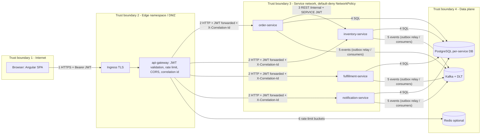

# Threat Model - OMS

Method: DFD with trust boundaries, STRIDE per element, then 10 named threats with controls separated into **Implemented in code** (verified on disk), **Demo-only**, and **Production-recommended**. Companion docs: `secure-coding-guide.md`, `docs/governance/risk-register.md`, `docs/governance/test-strategy.md`. Normative design: `docs/architecture/00-shared-contract.md`.

## 0. Verification legend and honest status

* **[code]** verified by reading classes under `services/platform-common/src/main/java/com/enterprise/oms/common/` or manifests under `infrastructure/`.
* **[tested]** a test class on disk exercises it (named in the threat).
* **[pending]** (historical marker, kept where a control is still not implemented or not run) first written when the service and gateway directories did not exist. As of 2026-10-18 all of them exist and have tests; the remaining open items are listed in `docs/known-limitations.md` and in the sections below. Controls tagged [pending] in this document that are verified in code now carry a status note.
* **[static]** only validated statically (kustomize/kubeconform/terraform validate); never applied to a cluster.
* Testcontainers tests are skipped on the dev machine (no Docker); embedded-Kafka and H2 tests do run.
* All data is synthetic. No real customer data or secrets are in the repository.

**Status 2026-10-18 (re-checked against the code):** all modules are implemented (gateway `EdgeSecurityConfig`, `RateLimitWebFilter`, `LoginThrottle`, `TokenController`; order-service `OrderSecurityConfig`, `RateLimitAdvice`; inventory, fulfillment and notification controllers). The reactor ran green (939 executed, 0 failed, 29 skipped for Docker) and the live checks (`scripts/live-flows.mjs` 54/54: cross-customer 404/403, customer sees `available` only, `/internal/**` 404 at the edge, forged and `alg:none` tokens 401) ran against the local stack. Gateway coverage: `EdgeSecurityTest`, `RoutingAndHeadersTest.internalPathsAreNeverRoutedEvenWithServiceOrAdminTokens`, `RateLimitTest`, `CorsTest` (wildcard origin fails startup), `TokenThrottleTest`/`LoginThrottleTest`, `NonDevProfileTest`. Service coverage: `OrderSecurityTest` (role matrix of every endpoint group, cross-customer, spoofed headers, SERVICE tokens), `InventoryApiTest#adjustValidationAndAuthorization`, `ProductApiTest`, `NotificationApiTest`, `FulfillmentApiTest`. Inventory has `CHECK` constraints and `ReservationConcurrencyTest` (H2) plus the live oversell run; order-service idempotency is scoped by `(scope, idem_key)` in `V11__saga_idempotency.sql`. Still open: PostgreSQL behaviour never run, OIDC/RS256 untested, consumer-side producer-ownership validation and dual-key JWT rotation not implemented, Kafka ACLs/TLS, NetworkPolicy enforcement unverified (no cluster), actuator health/prometheus unauthenticated.

## 1. Assets, actors, trust boundaries

Assets: orders and order history (A1), customer identity/email (A2), stock levels and reservations (A3), JWT signing secret (A4), audit trail (A5), Kafka topics and DLTs (A6), availability of the order path (A7).
Actors: anonymous internet user, CUSTOMER, OPERATOR, ADMIN, SERVICE (machine), malicious insider with cluster access, compromised dependency.

### Data flow diagram



```
Internet  | TB1 |  Edge  | TB2 |  Services  | TB3 |  Data
Browser --HTTPS--> Ingress --> Gateway --HTTP--> order/inventory/fulfillment/notification --> Postgres / Kafka / Redis
          (untrusted)      (authN, throttle)     (authZ again, backend-authoritative)        (per-service credentials)
```
Rule of this architecture: the gateway is a filter, not the only line of defence. Each service re-validates the JWT (`JwtSecurityAutoConfiguration`) and enforces roles and ownership itself.

## 2. STRIDE by element

| Element | S Spoofing | T Tampering | R Repudiation | I Info disclosure | D Denial of service | E Elevation of privilege |
|---|---|---|---|---|---|---|
| Browser/SPA (Angular or React) | stolen token reuse | client-side state edits (cart, ids, Redux or signal store) | user denies action | token in storage/logs | n/a | UI guard bypass (guards are UX only) |
| Gateway | forged/expired JWT; alg confusion | header injection (`X-Correlation-Id`) | missing edge log | verbose errors | request floods; large bodies | route to `/internal/**` |
| order/inventory/fulfillment/notification APIs | service call without token | mass assignment, body tampering | actor not recorded | cross-customer reads, verbose errors/PII in logs | oversized/expensive queries; unbounded page size | role escalation via claims, IDOR |
| Service-to-service REST | stolen SERVICE token | modified validate response | none | n/a | slow upstream (timeouts) | CUSTOMER token on `/internal` |
| Kafka topics | producer impersonation | forged/replayed events | event provenance | topics readable by any client | poison messages, flood | publishing privileged commands |
| PostgreSQL | shared credentials | SQL injection | audit row deletion | dumps/backups | lock contention | DB role too broad |
| Secrets (JWT secret, DB creds) | n/a | n/a | n/a | leak via env/log/repo | n/a | secret holder can mint ADMIN token |
| CI/CD and images | typosquat/dependency | tampered image/action | unsigned builds | secrets in logs | n/a | runner with prod credentials |

## 3. The ten threats

Residual risk scale: Low / Medium / High after the listed controls, considering honest verification status.

### T1 Unauthorized order access

* **Attack:** unauthenticated or wrongly-authenticated caller reads, creates or cancels orders: no token, expired, forged signature, `alg: none`, wrong audience/issuer, token from another system.
* **Impact:** confidentiality and integrity of orders; fraudulent orders/cancellations.
* **Controls implemented in code [code][tested]:** stateless resource server; `JwtTimestampValidator`, `JwtIssuerValidator`, audience claim validator; HS256 only (`MacAlgorithm.HS256`), so `alg: none` is rejected; `anyRequest().authenticated()`; 401/403 as problem+json with `WWW-Authenticate: Bearer` (`ProblemSecurityHandlers`); unknown roles ignored; method security enabled (`@EnableMethodSecurity`). Tests: `SecurityApiTest` (missing, garbage, expired, wrong audience, wrong issuer, other secret, tampered payload, `alg: none`, 403 via method security).
* **Demo-only:** HS256 with a shared secret; dev token endpoint with demo users (implemented in `gateway/auth/TokenController` + `DemoCredentials`, password from env, throttled by `LoginThrottle`, absent outside `dev`: `NonDevProfileTest`).
* **Production-recommended:** RS256 via IdP and JWKS (`oms.security.jwt.jwk-set-uri`), short token lifetime (demo `expiresIn: 3600`), refresh via the IdP, token revocation/`jti` deny list for high-risk events, MFA at the IdP for OPERATOR/ADMIN.
* **Tests:** `SecurityApiTest`; per-endpoint 401/403 matrices: `OrderSecurityTest#roleMatrixOfEveryEndpointGroup`, gateway `EdgeSecurityTest` (the planned `GatewayAuthTest`), `InventoryApiTest`, `NotificationApiTest`, `FulfillmentApiTest`.
* **Residual:** Low-Medium: endpoint matrices exist and pass on H2/embedded Kafka; OIDC mode and a real cluster are unverified.

### T2 Cross-customer exposure (IDOR / BOLA)

* **Attack:** customer1 requests `/api/v1/orders/{id}` of customer2, enumerates ids, passes another `customerId` in `GET /orders?customerId=` or in the POST body, reads another customer's notifications or customer record.
* **Impact:** disclosure of order contents and PII.
* **Controls in code [code]:** `CurrentUser.canAccessCustomer(UUID)` (staff, or customer whose token `customerId` equals the owner; malformed claim treated as absent); `CurrentUser.find/require`. **Contract rules [code][tested in order-service]:** foreign order returns 404 not 403 (no enumeration), customer list filter is forced from the token, POST `customerId` must equal the token's, UUID ids (not sequential).
* **Demo-only:** none specific; seed customers are synthetic.
* **Production-recommended:** row-level ownership assertion repeated in repository queries (`WHERE customer_id = :tokenCustomerId`) rather than load-then-check; security regression tests in CI; consider PostgreSQL row-level security as defence in depth.
* **Tests:** `SecurityApiTest.currentUserExposesIdRolesAndCustomerId` covers the identity extraction; e2e test "customer sees only own orders and a 404 for another customers order" runs in mock mode and live (18/18 on 2026-10-18). Also: `OrderSecurityTest#customerCannotReachOtherCustomersDataByAnyRoute`, `OrderApiTest#cancellingAnotherCustomersOrderIs404AndChangesNothing`, `CustomerApiTest#customerReadsSelfOnlyOthersAre404`.
* **Residual:** Medium until the real services enforce and test it.

### T3 Duplicate submission (replay, double click, retry)

* **Attack:** client or gateway retries `POST /orders`; attacker replays a captured request.
* **Impact:** duplicate orders and reservations; stock held; customer double-served.
* **Controls in code [code][tested]:** `IdempotencyKeys.require` (8-64 chars `[A-Za-z0-9_-]`, 400 on missing/malformed) and `fingerprint(body)` (SHA-256). Consumer side: `IdempotentEventProcessor` + `processed_events(consumer, event_id)` primary key; outbox relay marks `published_at`. Tests: `PageRequestFactoryTest.idempotencyKeyValidation`, `IdempotentProcessorAndAuditTest`, `ConsumerKafkaTest`. **Pending:** `idempotency_keys` table with caller-scoped uniqueness (key must be unique per authenticated caller so one user cannot probe or hijack another's key), replay returns original body with `Idempotent-Replay: true`, same key different body 422; unique `order_id` on reservations; unique (`source_event_id`, `template`) on notifications.
* **Demo-only:** none.
* **Production-recommended:** key TTL (for example 24 h) with cleanup; replay of a captured request after TTL is a new order, which is acceptable but should be rate-limited; request signing is out of scope.
* **Tests:** `IdempotencyApiTest` (replay, 422 reuse, 400 missing, concurrent same-key race: one order); e2e 5 and 5b (mock and live 18/18); live: 8 parallel requests with one key gave one order.
* **Residual:** Low-Medium.

### T4 Inventory manipulation

* **Attack:** oversell via concurrent reservations; negative stock adjustment below reserved; a customer calls stock adjust; forged `ReserveInventory`/`ReleaseInventory` commands drain or inflate stock; reservation hoarding (reserve and never confirm).
* **Impact:** financial/oversell loss, denial of stock to real buyers.
* **Controls [code][tested on H2]:** atomic conditional UPDATE `on_hand - reserved >= :q` (`AtomicUpdateReservationStrategy`; pessimistic and optimistic strategies also exist); sorted-id order; all-or-nothing transaction; `PUT /inventory/{id}/stock` restricted to OPERATOR/ADMIN, rejects result < reserved (409), writes `stock_movements` + audit (`AuditService`); reservation TTL (default 900 s) with `ReservationExpiryJob`; unique `order_id` on reservations; quantity limits 1..1000, max 50 lines. DB CHECK constraints exist in `V10__inventory_schema.sql`. Not proven on PostgreSQL (row locking, isolation).
* **Production-recommended:** alert on `reserved/on_hand` ratio, rate limit per customer on order creation, Kafka ACLs so only order-service can produce to `oms.inventory.commands.v1`.
* **Tests:** `ReservationConcurrencyTest` (H2 threads, every strategy), `InventoryApiTest`, `ReservationLifecycleTest`; live `tests/e2e/oversell-live.mjs` (30 parallel orders, stock 3: 3 FULFILLED, 27 REJECTED). PostgreSQL variants `InventoryPostgresIT`/`InventoryLocalPostgresIT` skipped without Docker; `performance/oversell.js` (k6) never run.
* **Residual:** Medium (no inventory code on disk yet).

### T5 SQL injection

* **Attack:** malicious `q`, `sort`, `category`, `status` parameters; injection via JSON fields; second-order injection via stored text.
* **Impact:** data theft/modification; full DB compromise of one service DB.
* **Controls in code [code][tested]:** `PageRequestFactory` rejects non-whitelisted sort fields and out-of-range paging with 400 (`PageRequestFactoryTest.rejectsOversizeNegativePageAndUnknownSortFields`); JPA with `spring.jpa.hibernate.ddl-auto=none`; `server.error.include-*=never` and `GlobalExceptionHandler` keep SQL text out of responses; `OutboxEventRepository` uses named parameters (`@Param`). Design rules [pending]: Spring Data derived/`@Query` with bind parameters only; the conditional-UPDATE uses `:q`/`:id` binds.
* **Demo-only:** H2 in PostgreSQL mode (different parser than PostgreSQL).
* **Production-recommended:** least-privilege DB roles per service (no DDL at runtime role; Flyway uses a separate migration role), Semgrep rules for string concatenation (already in CI: `p/java`), WAF rules at ingress.
* **Tests:** `PageRequestFactoryTest`; `ProductApiTest#sqlInjectionAttemptsInFiltersAreJustLiterals` (inventory). Probes against the other list endpoints (`q='; DROP TABLE--`, `sort=name;delete`) were not written (open).
* **Residual:** Low (parameterized by construction) once probes exist.

### T6 Privilege escalation

* **Attack:** CUSTOMER calls ADMIN/OPERATOR endpoints; token claim tampering (`roles`); CUSTOMER token on `/api/v1/internal/**`; UI guard bypass; a compromised service forges an ADMIN token.
* **Impact:** full data access, stock/product/customer changes, reconciliation triggers.
* **Controls in code [code][tested]:** signature verification (tampered payload and wrong-secret tokens rejected); `/api/v1/internal/**` requires `ROLE_SERVICE` (`internalEndpointsRequireServiceRole`); roles mapped from the `roles` claim only for the 4 known values; method security 403 as problem+json. Authorization matrix in contract section 4 [pending per endpoint]. UI guards (`frontend/oms-ui/src/app/core/auth/guards.ts`) are explicitly UX-only.
* **Demo-only:** one shared HS256 secret across all services and the gateway: **any component holding it can mint a token with any role, including ADMIN.** This is the largest structural weakness of the demo.
* **Production-recommended:** RS256 with the IdP holding the only private key; services verify with JWKS and cannot mint; SERVICE identity via Kubernetes projected service-account tokens or mTLS (SPIFFE) rather than a shared secret; no ADMIN role without MFA; admin actions audited.
* **Tests:** `SecurityApiTest` (above); `OrderSecurityTest#roleMatrixOfEveryEndpointGroup`, `#spoofedRoleHeadersParametersAndUnknownRoleClaimsGrantNothing`; gateway `EdgeSecurityTest`.
* **Residual:** High in HS256 demo mode; Medium with RS256/JWKS.

### T7 Forged events (Kafka)

* **Attack:** an actor with network access to the broker publishes `InventoryReserved`, `FulfillmentCompleted`, `OrderConfirmed` or commands to mark orders fulfilled, release stock, or spam notifications; replays old events; sends malformed events to block a partition.
* **Impact:** state corruption bypassing all HTTP authorization.
* **Controls in code [code][tested]:** idempotent consumers (replay of the same `eventId` is a no-op); malformed JSON goes to DLT without blocking the partition; unknown `eventType` ignored and counted; tolerant reader; strict envelope parsing (`EventEnvelope`, `MalformedEventException`); state machine rejects invalid transitions [pending]. Tests: `ConsumerKafkaTest`, `EventEnvelopeTest`. Network: default-deny NetworkPolicies allow only service pods to reach Kafka [static].
* **Demo-only:** Compose and dev Kafka are PLAINTEXT with no authentication or ACLs; the envelope is unsigned; `producer` field is self-asserted.
* **Production-recommended:** MSK with TLS plus SASL/IAM or mTLS; per-service principals with topic ACLs (only order-service may write `*.commands.v1` and `order.events`, only inventory writes `inventory.events`, and so on); consumer validates `producer` against topic owner and validates payload against `specs/events` schemas; optional message signing (JWS) for cross-trust-zone topics; alert on unexpected producer ids.
* **Tests:** `ConsumerKafkaTest` (poison, malformed, unknown type), `OrderResilienceKafkaIT`; schema validation of 218 live records by `scripts/validate-events.mjs` (offline, not a consumer-side check). Still not implemented: a consumer rejecting an event whose `producer` does not own the topic (open, `docs/known-limitations.md`).
* **Residual:** High in demo (any pod-level or compose-network actor); Medium with ACLs and TLS.

### T8 Sensitive information in logs

* **Attack:** tokens, passwords, full emails, or PII written to application logs, audit `detail`, error responses, metrics labels or traces; log forging with CR/LF in user input; tokens in URLs.
* **Impact:** credential theft via log access; privacy exposure; forged log lines.
* **Controls in code [code][tested]:** `LogMasking.maskEmail` (`a***@domain`), `maskToken`, `sanitize` (bearer, raw JWT, `password=`/`secret=`/`token=`/`authorization=`/`api-key=` pairs, emails), `stripNewlines` (log forging); `JwtSecret.toString()` does not print the secret; `server.error.include-message=never`, stack traces never in responses; `management.endpoint.health.show-details=never`; logging contract: JSON fields whitelist in `logback-spring.xml`. Test: `LogMaskingTest`.
* **Gaps:** masking is opt-in (a developer must call it); audit `detail` is free text up to 8000 chars with no automatic scrub (review rule in `code-review-checklist.md`); `LogMasking` regexes do not cover phone numbers, addresses, or card-like numbers (none handled by this system by design).
* **Demo-only:** `run-local.sh` prints the generated demo password to the console by design.
* **Production-recommended:** central log scrubber in the shipper (Promtail/OTel processors), restricted log access with audit, retention limits, never use customer identifiers as metric tags, trace attributes allow-list.
* **Tests:** `LogMaskingTest`, `OrderTransitionsLoggingTest`; live JSON logs (`docs/validation/correlation-trace-sample.md`) show masked e-mail. Not written (open): a log-scan integration test that fails on e-mail/JWT patterns in captured service logs.
* **Residual:** Medium (opt-in masking).

### T9 Denial of service

* **Attack:** request floods; oversized bodies; deep pagination (`size=100000`); expensive searches; slow-loris; Kafka poison messages; retry storms against inventory; reservation hoarding; log flooding.
* **Impact:** order path unavailable; cost.
* **Controls in code [code][tested]:** `RequestSizeLimitFilter` (64 KB, 413 problem+json, counts chunked bodies); `PageRequestFactory` caps size at 100; `server.max-http-request-header-size=16KB`; form post limit 64KB; multipart disabled; outbound timeouts connect 2 s / read 3 s (`OmsRestClientFactory`); consumer retry bounded (4 attempts then DLT); graceful shutdown. Manifests [static]: resource requests/limits, HPA, PDB, readiness probes. **Pending:** gateway rate limiting with Redis + in-memory fallback (`RATE_LIMITED`/429 + `Retry-After`), circuit breaker around inventory validation, saga max attempts.
* **Demo-only:** rate limits with in-memory buckets are per-pod (not global).
* **Production-recommended:** WAF/CDN rate limiting at ingress, per-customer quotas, connection limits, bulkheads, autoscaling by Kafka lag (KEDA example), alerting on saturation, request timeouts at gateway (10 s per contract).
* **Tests:** `WebFiltersTest` (413 and chunked), `PageRequestFactoryTest`, `OutboxRelayResilienceTest`, gateway `RateLimitTest`, order `RateLimitApiTest`; k6 `performance/order-flow.js` never run (open).
* **Residual:** Medium.

### T10 Misconfigured service-to-service access

* **Attack:** services reachable directly from any pod; `/api/v1/internal/**` exposed through the gateway or ingress; permissive NetworkPolicy; SERVICE token with long lifetime or reused; `management` endpoints (prometheus) reachable by anyone; shared DB credentials; services trusting `X-Correlation-Id`/identity headers; CORS `*`.
* **Impact:** bypass of gateway controls; lateral movement.
* **Controls in code [code][tested]:** `/api/v1/internal/**` SERVICE-only in every service (`internalEndpointsRequireServiceRole`); services re-validate JWTs instead of trusting the gateway; `ServiceTokenProvider` mints short-lived SERVICE tokens (`sub: svc-order-service`); correlation id sanitised or regenerated (`WebFiltersTest.correlationFilterGeneratesIdWhenMissingOrUnsafe`); `security headers` (nosniff, frame deny, no-referrer, HSTS). **Manifests [static]:** `networkpolicies.yaml` default-deny ingress+egress, DNS egress, ingress controller only to edge/ui, gateway and order-service only to services (order to inventory on 18082), service-to-data allow rules; `automountServiceAccountToken: false`; non-root, read-only root FS, dropped capabilities, PSA restricted namespace; per-service DB users in `oms-secrets` (keys `<svc>-db-username|password`). **Pending:** gateway must not route `/api/v1/internal/**`.
* **Demo-only:** `/actuator/prometheus` and health are `permitAll` on the service port; one shared HS256 secret; the managed-service `ipBlock 10.0.0.0/8` is a placeholder; NetworkPolicies need a CNI that enforces them and were never applied.
* **Production-recommended:** separate management port restricted by NetworkPolicy to the monitoring namespace; mTLS service mesh or SPIFFE identities; per-service credentials with least privilege; audience claim per service (`aud` currently `oms-api` for all); egress allow-lists to exact CIDRs/endpoints; CORS allow-list only (`OMS_GATEWAY_CORS_ALLOWED_ORIGINS`).
* **Tests:** `SecurityApiTest.internalEndpointsRequireServiceRole`; gateway `RoutingAndHeadersTest.internalPathsAreNeverRoutedEvenWithServiceOrAdminTokens` (the planned `InternalRouteBlockedTest`); live: `/api/v1/internal/**` 404 at the edge. NetworkPolicy connectivity test on a real cluster remains open (no cluster).
* **Residual:** Medium-High until the policies are verified on a cluster.

## 4. Summary matrix

| Threat | Implemented and tested (platform-common, services, gateway) | Still open (2026-10-18) | Residual |
|---|---|---|---|
| T1 Unauthorized order access | JWT validation, 401/403 handlers, endpoint role matrices (`OrderSecurityTest`, `EdgeSecurityTest`) | OIDC/RS256 untested | Low-Medium |
| T2 Cross-customer exposure | `CurrentUser.canAccessCustomer`, 404 rule and forced filters in order/notification (`OrderSecurityTest`, live cross-customer checks) | none known | Low |
| T3 Duplicate submission | `IdempotencyKeys`, `IdempotentEventProcessor`, outbox, `idempotency_keys` + unique constraints (`IdempotencyApiTest`) | PostgreSQL run of the constraints | Low |
| T4 Inventory manipulation | atomic reservation, TTL, stock rules, audit (`ReservationConcurrencyTest`, `InventoryApiTest`, live oversell) | PostgreSQL row locking never run; k6 never run | Low-Medium |
| T5 SQL injection | sort whitelist, error hygiene, parameter binding; `ProductApiTest` injection probe | probes for the other list endpoints | Low |
| T6 Privilege escalation | signature, internal SERVICE rule, per-endpoint roles (`OrderSecurityTest`) | RS256/JWKS untested; dual-key rotation not implemented | Medium (demo HS256) |
| T7 Forged events | idempotency, DLT, tolerant reader, 15 event schemas validated offline | producer-ownership check, Kafka ACLs/TLS | High (demo) |
| T8 Sensitive logs | `LogMasking`, `LogMaskingTest`, masked live logs | log-scan test | Medium |
| T9 DoS | size limit, paging caps, timeouts, rate limiters (`RateLimitTest`, `RateLimitApiTest`), breakers (`InventoryClientResilienceTest`, gateway `ResilienceTest`, `BulkheadConcurrencyTest`) | k6 load test never run; Redis limiter never ran on real Redis | Medium |
| T10 S2S misconfig | internal rule, short SERVICE tokens, gateway route block (tested), NetworkPolicies [static] | cluster verification (no cluster); OIDC mode has no SERVICE token | Medium-High |

## 5. Test matrix (existing vs still open)

| Threat | Existing test (path under `services/platform-common/src/test/java/com/enterprise/oms/common/` unless noted) | Still open |
|---|---|---|
| T1 | `security/SecurityApiTest` (8 token-failure cases + 403); `OrderSecurityTest`; gateway `EdgeSecurityTest` | OIDC/JWKS test |
| T2 | `security/SecurityApiTest.currentUserExposesIdRolesAndCustomerId`; `OrderSecurityTest#customerCannotReachOtherCustomersDataByAnyRoute`; `OrderApiTest`; `tests/e2e/specs/order-lifecycle.spec.ts` (live 18/18) | none |
| T3 | `web/PageRequestFactoryTest.idempotencyKeyValidation`, `idempotency/IdempotentProcessorAndAuditTest`, `messaging/ConsumerKafkaTest`; order-service `IdempotencyApiTest` | PostgreSQL twin |
| T4 | `ReservationConcurrencyTest`, `InventoryApiTest` (inventory-service); `tests/e2e/oversell-live.mjs` | `InventoryPostgresIT` run, k6 `oversell.js` run |
| T5 | `web/PageRequestFactoryTest`; inventory `ProductApiTest#sqlInjectionAttemptsInFiltersAreJustLiterals` | probes on other list endpoints |
| T6 | `security/SecurityApiTest` (tampered, other secret, `alg:none`, unknown roles, internal); `OrderSecurityTest` role matrix | RS256 test |
| T7 | `messaging/ConsumerKafkaTest`, `events/EventEnvelopeTest` | producer-ownership validation test (feature not implemented) |
| T8 | `observability/LogMaskingTest`, order-service `OrderTransitionsLoggingTest` | log-scan test |
| T9 | `web/WebFiltersTest`, `web/PageRequestFactoryTest`, `outbox/OutboxRelayResilienceTest`, gateway `RateLimitTest`, order `RateLimitApiTest` | k6 load test |
| T10 | `security/SecurityApiTest.internalEndpointsRequireServiceRole`; gateway `RoutingAndHeadersTest` | cluster NetworkPolicy test |

## 6. OWASP Top 10 (2021) mapping

| ID | Category | OMS exposure and control | Status |
|---|---|---|---|
| A01 | Broken Access Control | role checks, `CurrentUser.canAccessCustomer`, 404 for foreign resources, SERVICE-only internal APIs | platform parts and endpoints [tested] (`OrderSecurityTest`, `EdgeSecurityTest`, live cross-customer checks) |
| A02 | Cryptographic Failures | TLS at ingress [static]; HS256 secret >= 32 bytes enforced (`JwtSecret`); secrets never in code; HSTS header; plaintext Kafka/DB inside the demo network | partial; demo plaintext data plane |
| A03 | Injection | parameter binding, sort whitelist, JSON binding; no dynamic SQL by rule | `PageRequestFactory` [tested]; inventory filters [tested] (`ProductApiTest`); probes on other endpoints open |
| A04 | Insecure Design | threat model, idempotency, saga compensation, state machine, 404-not-403 | this document |
| A05 | Security Misconfiguration | secure defaults (`oms-defaults.properties`: no stack traces, health details never, multipart off), non-root read-only containers, PSA restricted, NetworkPolicies; demo permitAll prometheus; base ConfigMap defaults to `dev` profile | [code]/[static]; see section 7 |
| A06 | Vulnerable and Outdated Components | Trivy fs/image, `npm audit`, Dependabot recommended, version pinning; Actions and images not SHA/digest-pinned yet | CI defined, never executed |
| A07 | Identification and Authentication Failures | JWT validation of exp/iss/aud/signature; fail-fast secret; generic login error in UI; no default demo password | [tested]; MFA/lockout are IdP concerns (production-recommended) |
| A08 | Software and Data Integrity Failures | idempotent consumers, unsigned events (gap), CI supply chain (tags not SHAs), npm `--ignore-scripts` in CI | partial |
| A09 | Security Logging and Monitoring Failures | audit_events + `/ops/audit`, correlation id, JSON logs, `LogMasking`, alert rules in `observability/prometheus/rules/oms-alerts.yml` | [code]; alerts [static] |
| A10 | Server-Side Request Forgery | no user-supplied URLs are fetched; service URLs are static config; NetworkPolicy egress limits | Low exposure |

## 7. OWASP API Security Top 10 (2023) mapping

| ID | Category | OMS control | Status |
|---|---|---|---|
| API1 | Broken Object Level Authorization | `canAccessCustomer`, 404 for foreign orders, forced list filters, UUID ids | helper and endpoints [tested] (`OrderSecurityTest`, `OrderApiTest`, live) |
| API2 | Broken Authentication | JWT validators, no `alg:none`, no default secret/password | [tested] |
| API3 | Broken Object Property Level Authorization | role-shaped Product JSON (customers get `available` only), no mass assignment (DTO records, not entities) | [code]; customers see `available` only (live-flows) |
| API4 | Unrestricted Resource Consumption | 64 KB body limit, page size <= 100, timeouts, rate limit, saga max attempts | size/paging [tested]; rate limit [tested] (gateway `RateLimitTest`, order `RateLimitApiTest`; per instance unless Redis, never run on real Redis) |
| API5 | Broken Function Level Authorization | admin/ops/internal routes separated by role; gateway does not route internal | internal rule [tested]; role matrices [tested] (`OrderSecurityTest`) |
| API6 | Unrestricted Access to Sensitive Business Flows | idempotency on order creation, quantity/line limits, reservation TTL, rate limiting | [tested] (`IdempotencyApiTest`, `ReservationLifecycleTest`, rate-limit tests) |
| API7 | Server Side Request Forgery | not applicable (no user-controlled outbound URLs) | n/a |
| API8 | Security Misconfiguration | CORS allow-list (same-origin UI), security headers, problem+json without internals, actuator exposure limited to health/info/prometheus | [code]; CORS [tested] (`CorsTest`) |
| API9 | Improper Inventory Management | OpenAPI exports in `specs/openapi` (exist: 4 service exports + generated gateway file), `/v3/api-docs` is public in demo (restrict in prod), additive-only v1, one version live | partial |
| API10 | Unsafe Consumption of APIs | validation of upstream responses, timeouts, circuit breaker on inventory call, tolerant-reader plus schema validation for events | breaker [tested] (`InventoryClientResilienceTest`); event schemas exist (`specs/events`) and were validated offline; consumer-side schema validation not implemented (open) |

## 8. Demo-only vs production controls

| Area | Demo / dev (this repo) | Production requirement |
|---|---|---|
| Token signing | HS256, shared `OMS_JWT_SECRET` | RS256 + JWKS from IdP; secret not shared by services |
| Token issuance | gateway dev endpoint (`dev` profile) with demo users and `OMS_DEMO_PASSWORD` | IdP login (OIDC code flow + PKCE), MFA for staff |
| Seed data | Flyway `V1000+` in `dev` | none in prod |
| Kafka | PLAINTEXT, no ACLs | TLS + SASL/mTLS + ACLs per principal |
| Database | in-cluster, plaintext, single replica; H2 locally | RDS Multi-AZ, TLS, per-service roles, backups, rotation |
| Redis | optional, in-memory fallback | authenticated TLS ElastiCache or none |
| Actuator | health/prometheus `permitAll` on service port; `/v3/api-docs` public | management port + NetworkPolicy; api-docs restricted |
| Service identity | SERVICE JWT from shared secret | SPIFFE/mTLS or projected SA tokens |
| NetworkPolicy | authored, not applied; `10.0.0.0/8` placeholder | enforced CNI, tight CIDRs |
| Images/CI | tags, major-tag Actions | digests, SHA-pinned Actions, signed images, SBOM |
| Observability | sampling 1.0 in dev, console password print | sampling 0.05, no secret output, log access control |
| Audit table | append-only by convention | DB role without UPDATE/DELETE, export to WORM storage |
| Ingress/TLS | example hostnames | managed certificates, WAF, HSTS preload decision |

Inherited defaults flagged earlier and **resolved in the integration pass** (section 10): `base/configmap.yaml` no longer defaults to `dev` (base = `json-logs`; each overlay sets its own); `/v3/api-docs` and Swagger UI are switched off by the `prod` profile of every service (test: `ProdProfileDocsDisabledTest`). Still true: `JwtSecurityAutoConfiguration` permits `/swagger-ui/**` and `/v3/api-docs/**` at the security layer, which is harmless in prod only because the springdoc endpoints themselves are disabled there.

## 9. Secrets management

| Topic | Design |
|---|---|
| The signing secret | env `OMS_JWT_SECRET`, at least 32 bytes. **No default** in the prod profile: `JwtSecret.resolve` fails startup when absent or short (verified by `JwtSecretTest`: failsFastWhenAbsent, failsFastWhenShorterThan32Bytes, `applicationStartupFailsFast*`). `allow-ephemeral-secret=true` generates a random in-memory secret and is for tests/single-process only; it must never appear in a prod manifest (CI grep gate recommended). |
| Local | `scripts/run-local.sh` generates a random secret per run; `OMS_DEMO_PASSWORD` is generated and printed (demo-only). Tests generate secrets at runtime (`JwtTestTokens`, `JwtSecret.random()`). |
| Kubernetes | Pods read `oms-secrets` through `secretKeyRef` only (keys `jwt-secret`, `<svc>-db-username|password`, `postgres-password`, `redis-password`, optional `demo-password`). No overlay renders a Secret object (`scripts/validate-infra.sh` checks). dev/test: `infrastructure/kubernetes/examples/create-dev-secret.sh` streams random values to kubectl. `examples/secret.example.yaml` holds `NOT-A-REAL-SECRET` shape only and must never be applied. |
| Production source of truth | External Secrets Operator reading AWS Secrets Manager (`examples/externalsecret.example.yaml`; Terraform in `infrastructure/cloud/aws/terraform/secrets_observability.tf` generates the RDS password in Secrets Manager) or HashiCorp Vault via ESO/CSI; Sealed Secrets acceptable for GitOps (sealed output safe to commit, controller key is not). Enable etcd encryption at rest (EKS KMS envelope encryption) and restrict `get secrets` RBAC. |
| Rotation (HS256, interim) | Support two keys during rotation: add a second accepted verification key (planned enhancement: `oms.security.jwt.previous-secret`, not implemented), roll the new signing key to the issuer last, wait one token lifetime (1 h), remove the old key. Without dual-key support, rotation = rolling restart of ALL services plus gateway at once and all outstanding tokens become invalid. Rotate at least every 90 days and immediately on suspected exposure. |
| Rotation (DB credentials) | ESO refresh interval plus rolling restart (Spring needs a restart to rebuild the pool) or dynamic secrets via Vault. |
| JWKS migration (target) | 1) Introduce IdP (OIDC). 2) Set `oms.security.jwt.issuer-uri` and/or `jwk-set-uri` on services: platform-common switches to RS256 and the HS256 beans (`JwtTokenFactory`, `ServiceTokenProvider`) are not created. 3) Gateway becomes a pure resource server; dev token endpoint removed from prod builds. 4) Replace SERVICE JWT minting by client-credentials grant from the IdP or mTLS. 5) Delete `OMS_JWT_SECRET` from `oms-secrets`. Key rollover is then the IdP's JWKS rotation (publish new key, keep old for one token lifetime). |
| Detection | gitleaks in CI (`secret-scan` job); pre-commit hook recommended; never log secrets (`LogMasking`, `JwtSecret.toString`). |
| Incident | Suspected leak: rotate signing key, invalidate tokens, review `audit_events` for ADMIN actions in the exposure window, open a PIR (`docs/governance/post-incident-review-template.md`). |

## 10. Integration-pass security findings and caveats (live stack, 2026-10-18)

### 10.1 Environment profile defaults (fixed)
`infrastructure/kubernetes/base/configmap.yaml` shipped `SPRING_PROFILES_ACTIVE: "dev,json-logs"`; any overlay that forgot to patch it would have run production pods with the dev token endpoint, seed data and Swagger. The base is now `json-logs` only; the dev and test overlays set `dev,json-logs` explicitly (with a comment), prod sets `prod,json-logs`. Static check only: `kubectl kustomize`/apply was never run (no cluster).

### 10.2 OpenAPI and Swagger UI are off in `prod` (fixed, tested)
`springdoc.api-docs.enabled=false` and `springdoc.swagger-ui.enabled=false` in the `prod` profile of order-, inventory-, fulfillment- and notification-service (previously only the UI was off in three of them, and api-docs stayed on in all four). Regression test per service: `ProdProfileDocsDisabledTest` loads the real `application*.yml` through Spring Boot's config-data loader with `spring.profiles.active=prod` and asserts both flags are `false`, plus a control that `dev` does not disable them. Limits of the evidence: it proves the configuration, not an HTTP 404 from a running prod-profile service (prod needs PostgreSQL, which was not available). The gateway has no springdoc dependency at all and has no route for `/v3/api-docs` or `/swagger-ui`; verified live (`GET :18080/v3/api-docs` and `/swagger-ui.html` answer 401 without a token and 404 with one; `/swagger-ui/index.html` 404), and `scripts/export-openapi.mjs` therefore reads the services directly.

### 10.3 HS256 shared secret: caveat and production path
Demo mode signs and verifies every token with ONE symmetric secret (`OMS_JWT_SECRET`) that the gateway and all four services hold. Consequences: any holder of the secret (any compromised service, anyone who can read the env/Secret object) can mint a token for any role including ADMIN and SERVICE; there is no per-service identity, no key id and no clean rotation (rotation = restart everything at once, all tokens invalid; dual-key support is not implemented). The secret is random per run, never in the repo, and startup fails when it is missing or shorter than 32 bytes; that makes the demo safe to run, not the design safe for production.

Production move: RS256 with JWKS from an OIDC provider (Keycloak/Cognito/Entra). Wiring that exists: platform-common (`JwtSecurityAutoConfiguration`, servlet services) and the gateway (`EdgeSecurityConfig`, reactive) switch to `NimbusJwtDecoder.withJwkSetUri` / `JwtDecoders.fromIssuerLocation` when `oms.security.jwt.issuer-uri` and/or `oms.security.jwt.jwk-set-uri` is set, keep the audience and timestamp validators, and in that mode do not create the HS256 beans. **Not tested:** there is no test, and no IdP was available, for either OIDC path (verified by reading the code only; `grep` finds no test referencing `jwk-set-uri`/`issuer-uri`). Known gaps to close before relying on it: (1) in OIDC mode `ServiceTokenProvider` is not created, so `OmsRestClientFactory` (order -> inventory validation call) sends no SERVICE token and inventory's `/api/v1/internal/**` (role SERVICE) would answer 401: a client-credentials token source (or mTLS) must be added; (2) the `roles` and `customerId` claim names must be mapped from the IdP's claims; (3) the dev token endpoint must stay out of prod builds (already only active in profile `dev`).

### 10.4 `/actuator/prometheus` exposure
`/actuator/health/**`, `/actuator/info` and `/actuator/prometheus` are `permitAll` on every service's main port (`JwtSecurityAutoConfiguration`), and the metrics carry business labels (topic names, outcome counts, route/URI tags, JVM and pool details). Verified live: the gateway does not route the SERVICES' `/actuator/**` (`GET :18080/api/v1/ops/order/../../../actuator/prometheus` is 404), but the gateway's OWN `/actuator/health` and `/actuator/prometheus` are served unauthenticated on its public port 18080 (the Prometheus scrape in `scripts/check-metric-names.mjs` reads it without a token), and anyone who can reach a service port directly can scrape that service. In Kubernetes the Ingress only forwards `/api` (to the gateway) and `/` (to the frontend), so `/actuator` is not reachable from outside by manifest (static check only, never applied). Production requirements: (a) put actuator on a separate management port (`management.server.port`) that is not in the Service/Ingress and is reachable only from the Prometheus namespace through a NetworkPolicy, or (b) require authentication on `/actuator/prometheus` (basic auth or bearer for the scraper) and keep only `health/liveness|readiness` open for the kubelet; (c) never add `uri` tags with raw ids (templates only, as Spring MVC does) and keep PII out of metric labels. The Kubernetes manifests in this repo (`networkpolicies.yaml`, `servicemonitor.yaml`) were validated statically only; neither option (a) nor (b) is implemented in code, so this remains an open production hardening item, not a closed one.

## 11. React front end notes (`frontend/oms-ui-react`, added 2026-10-19)

The browser trust boundary (TB1) now contains either of two SPAs (Angular or React); both use the same gateway contract, so every backend control above applies unchanged. React-specific points, verified in the code unless marked otherwise:

* **XSS.** React escapes text nodes; the app renders all server strings (`statusReason`, names, notification bodies) as text, and there is no `dangerouslySetInnerHTML` and no `eval`. Residual risk: a future developer adding `dangerouslySetInnerHTML` or a vulnerable dependency (`npm audit` reported 0 vulnerabilities on 2026-10-19; Trivy and CodeQL jobs in CI never ran). The lint rules do not forbid `dangerouslySetInnerHTML`: review catches it.
* **Token storage.** The access token lives in the Redux `auth` slice (memory) and is mirrored to `sessionStorage` (per tab, survives reload) so a refresh does not log the user out. Script running on the origin can read it, so any XSS can steal it (the same trade-off as the Angular store; never `localStorage`, never in URLs, never logged; the password is never stored). Production: authorization code with PKCE and a BFF issuing HttpOnly, Secure, SameSite cookies, so JavaScript never sees a token.
* **Token leakage paths.** The bearer token is attached only by `omsBaseQuery` to same-origin `/api/v1` calls and never to `/auth/token`. `returnUrl` after login accepts only same-app relative paths (no `//`, no scheme, no backslash), which blocks open-redirect abuse. On logout (or a 401) a listener middleware resets the RTK Query cache and clears the cart, so a later user of the same tab cannot see the previous session's data.
* **CSP caveat.** nginx sends `default-src 'self'; script-src 'self'; style-src 'self' 'unsafe-inline'; connect-src 'self'; frame-ancestors 'none'; object-src 'none'`. `style-src 'unsafe-inline'` is required because MUI/Emotion injects `<style>` tags at runtime (Angular Material needs the same exception). Consequence: an injected style can restyle or exfiltrate through CSS side channels, which is weaker than blocking inline styles; injected scripts remain blocked by `script-src 'self'` (the build emits no inline scripts). Fix: an Emotion cache with a per-response nonce and `style-src 'nonce-...'`; not done. The header was read from `nginx.conf`; the image was never built, so the live header was NOT observed.
* **Guards are UX.** `RequireAuth` and `RequireRole` only hide screens; the backend still returns 401/403/404 (T1, T2, T6). A user who edits the Redux state in DevTools gains no data.
* **Supply chain.** All dependencies are pinned to exact versions with a lockfile; `npm ci --ignore-scripts` is the intended CI install. React's ecosystem is larger (MUI, Emotion, RTK, React Router, RHF, Zod, MSW, Vitest), so the attack surface of the dev toolchain is larger than for Angular's single-vendor set.
* **Contract drift.** `src/models.ts` is a copy of the types; a drift would show up as wrong rendering, not as a security hole, but a missing field check (for example the null prices of REJECTED orders, defect D-03) can still blank a screen: covered by tests.
* **Not done:** automated accessibility and security scans of the running UI (ZAP, axe), a nonce-based CSP, SRI (no third-party assets exist), and browsers other than desktop Chrome.
