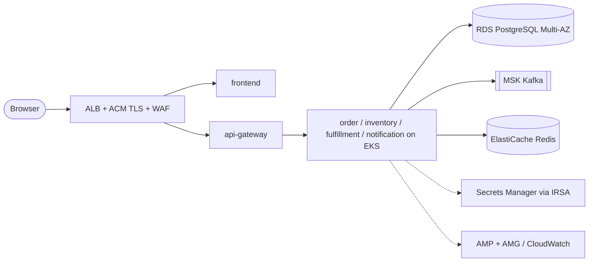

# Cloud reference architectures

Status: **design + Terraform skeleton for AWS; adaptation tables for Azure and GCP.** Nothing here has been applied, no cloud account was used, no cost or performance figures are claimed. `terraform validate` status is recorded in `scripts/validate-infra.sh` output (PASS only if it actually ran).

## 1. AWS (primary reference)

Diagram source: `diagrams/aws-reference.mmd` (Mermaid). Terraform: `aws/terraform/` (no credentials, no backend configured, no apply).

| Concern | AWS service | Notes |
|---|---|---|
| Compute | EKS (managed node group, 3 AZ) | private subnets, KMS-encrypted secrets, IRSA, audit logs on |
| Images | ECR | immutable tags, scan on push, lifecycle policy; deploy by digest |
| Ingress | ALB (AWS Load Balancer Controller) + ACM + WAF | terminate TLS at ALB; `/actuator` never routed |
| PostgreSQL | RDS PostgreSQL 16 Multi-AZ | one instance, four databases/roles (as in Compose), master secret generated by RDS (`manage_master_user_password`), 14-day backups, deletion protection. Larger shops: one instance per service |
| Kafka | MSK (IAM auth, TLS) | RF 3, min ISR 2, auto topic creation off; topics from the same topic job (contract section 7) |
| Redis | ElastiCache (replication group, TLS, AUTH) | rate limiting only; app degrades to in-memory if disabled |
| Secrets | Secrets Manager + External Secrets Operator | values never in Terraform state or Git |
| Observability | AMP (metrics) + AMG (dashboards) + CloudWatch Logs + ADOT/X-Ray or Tempo | same dashboards JSON works with AMP as the Prometheus source |
| CI/CD | GitHub Actions OIDC to AWS role (no long-lived keys) | see `.github/workflows/ci.yml` (deploy job is gated and not executed) |

Not in the skeleton (add before real use): ALB/WAF/Route 53 resources (managed by the controller/ingress), cluster add-ons (CNI network policy, EBS CSI, KEDA, External Secrets, kube-prometheus-stack), remote state backend, per-environment tfvars, cross-account/SCP guardrails, cost controls.

How to validate yourself: `terraform -chdir=infrastructure/cloud/aws/terraform init -backend=false && terraform -chdir=... validate` (needs network for provider download). `plan` needs credentials and `TF_VAR_redis_auth_token` from a secret store.

Tradeoff to state in interviews: one shared RDS instance is cheaper and simpler but couples blast radius and noisy-neighbour risk; the logical isolation (separate DB + role per service, no cross-DB access) keeps the migration to per-service instances mechanical.

## 2. Azure adaptation

| Concern | Azure equivalent | Changes needed |
|---|---|---|
| Compute | AKS (zones, Azure CNI + NetworkPolicy/Calico or Cilium) | same Kustomize overlays; ingress class `azure-application-gateway` or nginx |
| Images | ACR (content trust, Defender scan) | change image registry path in overlays |
| PostgreSQL | Azure Database for PostgreSQL Flexible Server (zone-redundant HA) | JDBC URL + `sslmode=require`; Entra ID auth optional |
| Kafka | Event Hubs (Kafka endpoint, Standard/Premium) or Confluent Cloud on Azure | bootstrap `<ns>.servicebus.windows.net:9093`, SASL_SSL PLAIN with connection string via Key Vault. Event Hubs lacks some Kafka features (e.g. compaction limits, transactions on lower tiers): verify the idempotent producer (`enable.idempotence`) support before choosing |
| Redis | Azure Cache for Redis | TLS 6380 |
| Secrets | Key Vault + Secrets Store CSI driver or External Secrets; Workload Identity | ExternalSecret `SecretStore` provider swap |
| Observability | Azure Monitor managed Prometheus + Managed Grafana + Application Insights (OTLP) | keep ServiceMonitor/PrometheusRule |

## 3. GCP adaptation

| Concern | GCP equivalent | Changes needed |
|---|---|---|
| Compute | GKE (Autopilot or Standard, regional) | NetworkPolicy via Dataplane V2 |
| Images | Artifact Registry (+ Binary Authorization) | registry path |
| PostgreSQL | Cloud SQL for PostgreSQL (HA, private IP) + Cloud SQL Auth Proxy sidecar or private service access | JDBC URL via proxy/IAM |
| Kafka | Google Managed Service for Apache Kafka, or Confluent Cloud | SASL/OAUTHBEARER (managed Kafka) |
| Redis | Memorystore for Redis | AUTH + in-transit encryption |
| Secrets | Secret Manager + External Secrets; Workload Identity Federation | SecretStore provider swap |
| Observability | Managed Service for Prometheus + Cloud Logging/Trace (OTLP) | collector exporter swap |

## 4. What stays identical everywhere

Container images, Kustomize base, probes/graceful shutdown, NetworkPolicies, metric names, the contract's Kafka topology and the application configuration (all environment-driven). Only endpoints, auth mechanisms (IAM/SASL) and secret sources change per cloud.
